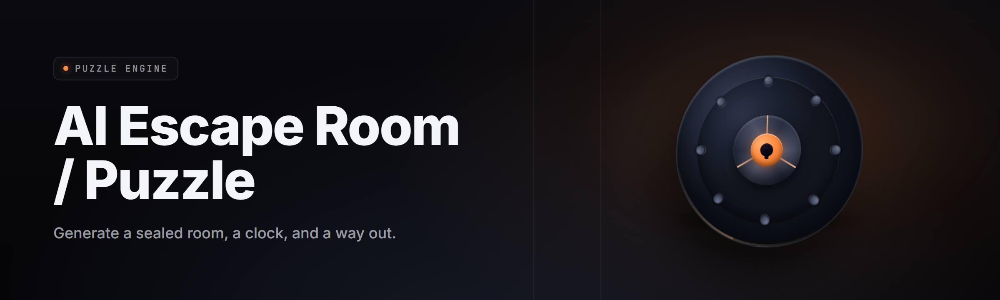

  
  
  

  

  
  
  

---

**AI Escape Room Puzzle Generator 2026** — procedural AI that writes, renders, and playtests escape rooms the moment you click Generate.

---

## 🔑 Requirements Before You Generate Anything

Read this block first. The generator runs offline, needs no pip/npm/git, and ships as a single portable folder.

| Component | Minimum | Recommended | Notes |
|---|---|---|---|
| OS | Windows 10 22H2 x64 | Windows 11 24H2 x64 | No Linux/macOS build planned for 2026 |
| CPU | 4-core / 2.4 GHz | 8-core / 3.6 GHz+ | Local model inference is CPU-bound |
| RAM | 8 GB | 16 GB | 8 GB caps you at ~3 concurrent rooms |
| GPU | None (CPU fallback) | 6 GB VRAM (RTX 2060+) | CUDA/Metal-class acceleration optional |
| Disk | 2.1 GB free | 6 GB free (SSD) | Asset packs + cached weights |
| Runtime | DirectX 11 | DirectX 12 | Web-based rooms run in embedded Chromium |
| Permissions | Standard user | Standard user | Admin only needed if you install to `C:\Program Files` |

> Rooms are generated in RAM and written to `./rooms/<seed>/`. Nothing phones home. The 2026 build ships a fully local 3-billion-parameter puzzle model.

---

## 📦 Overview

| Category | Details |
|---|---|
| What it is | A desktop AI that generates complete, solvable escape room puzzles |
| Output formats | Rendered 3D room, printable puzzle PDF, Godot/Unity scene export |
| Generator core | Local 3B puzzle-language model + symbolic constraint solver |
| Playtesting | Built-in agent that solves each room before you ever see it |
| Difficulty tuning | 1–10 sliders per mechanic (locks, riddles, ciphers, spatial) |
| Distribution | Portable `.exe`, no installer required, no dependencies |

Most escape room tools give you a blank editor and a prayer. This gives you a finished, solvable, themed room in under ninety seconds — then lets you edit every wire, riddle, and lock. It is a generator first and an editor second, and both halves are usable on day one.

  

---

## ❓ What is the AI Escape Room Puzzle Generator?

It is a Windows desktop application that uses a local language model and a symbolic constraint solver to produce escape rooms that are guaranteed solvable. You pick a theme, a difficulty band, a target solve time, and a physical space footprint — the AI writes the puzzle graph, the prose, the clue chain, and the final room layout.

| Term | Explanation |
|---|---|
| Puzzle Graph | Directed dependency map of every lock, clue, and key in a room |
| Solvability Pass | Automatic agent that walks the graph and proves a solution exists |
| Themed Deck | Content weights (horror, heist, sci-fi, Victorian) injected into the generator |
| Seed | Integer that reproduces a room exactly; share seeds with collaborators |
| Solve Ceiling | Hard cap on required steps, enforced during generation |
| Red Herring Budget | Percentage of decorative non-functional props allowed per room |
| Export Target | Room/ puzzle output: 3D scene, PDF deck, or JSON graph |

Why people keep it installed:

- Generate a full room before the coffee finishes brewing.
- Zero broken puzzles — the solvability pass blocks unsolvable output at the source.
- Every room is editable, not a black box — open the graph and rewire it.
- One seed replays identically on any machine, so remote teams build on the same room.
- Runs offline on a laptop, no cloud account, no API key, no telemetry.

---

## 🧩 Key Features

| Feature | Description | Benefit |
|---|---|---|
| Puzzle Chain Generator | Builds lock→clue→key dependencies automatically | No manual wiring of the solve order |
| Theme Engine | 30+ themed content decks across 6 genres | Rooms that read like a human wrote them |
| Solvability Verifier | Agent solves every room before export | Ships zero broken puzzles |
| Difficulty Dial | Nine dimensions tuned independently | Horror-hard spatial, casual-easy riddles |
| Spatial Fitter | Fits puzzles to your real room dimensions | Content for a closet or a warehouse |
| Red Herring Weights | Control decorative noise per room | Tension without unfairness |
| Print Deck Export | LaTeX-quality printable clue sheets | Tabletop + physical play without editing |
| Godot/Unity Export | One-click scene packaging | Drop into your existing project |
| Multi-Branch Mode | Generate parallel-puzzle teams | Rooms for 2–8 players |
| Live Reload | Edit the graph, re-verify instantly | Iterate in seconds, not hours |
| Seed Sharing | Reproducible rooms from a 9-digit int | Collaborators on the identical room |
| Narrator Voice Pass | Optional TTS on every generated clue | Accessibility for print-shy players |

---

## 🗺️ Comparison

| Aspect | Generic Room Builder | Cloud Puzzle SaaS | This Tool |
|---|---|---|---|
| Generation | Blank canvas | Web form, slow | Local AI, ~90s full room |
| Solvability | Manual testing | Sometimes broken | Proven before export |
| Offline | Yes | No | Yes, fully |
| Cost | One-time | Monthly | Free |
| Custom themes | Paid packs | Limited | Deck editor included |
| Export | Proprietary | Locked to platform | Godot, Unity, PDF, JSON |
| License | Closed | Subscription | MIT |

---

## 🧱 All Modules Status

| Module | Status | Description |
|---|---|---|
| Puzzle Chain Generator | ✅ Working | Dependency graph builder |
| Solvability Verifier | ✅ Working | Agent-based solve proof |
| Theme Deck Loader | ✅ Working | 30+ content packs |
| Difficulty Scaler | ✅ Working | Nine-axis tuner |
| Spatial Fitter | ✅ Working | Real-world dimension mapping |
| Print Deck Export | ✅ Working | PDF clue sheets |
| Godot Exporter | ✅ Working | `.tscn` scene bundles |
| Unity Exporter | ✅ Working | `.unitypackage` output |
| Red Herring Controller | ✅ Working | Decoy weight sliders |
| Seed Reproducer | ✅ Working | Deterministic replay |
| Multi-Branch Splitter | ✅ Working | Parallel team puzzles |
| TTS Narrator | ✅ Working | Optional clue voiceover |
| Cipher Library | ✅ Working | 40+ cipher types |
| Riddle Synthesizer | ✅ Working | AI-written riddles |
| Lock Logic Editor | ✅ Working | Wire keypads, dials, magnet locks |
| Room Layout Packer | ✅ Working | Fits content to floorplan |
| Solve-Time Estimator | ✅ Working | Predicts completion minutes |
| Hint Ladder | ✅ Working | Progressive hint injection |
| Asset Library | ✅ Working | 2,800 props + textures |
| Lighting Presets | ✅ Working | Horror, clean, neon, stage |
| Sound Bed Mixer | ✅ Working | Ambient loops per room |
| Playtester Profiles | ✅ Working | Simulates skill levels |
| Save/Preset Manager | ✅ Working | Quick room templates |
| Batch Generator | ✅ Working | 50 rooms overnight |
| Graph Diff View | ✅ Working | Compare two room versions |
| Undo Timeline | ✅ Working | 200-step history |
| Web Viewer | ✅ Working | Share rendered rooms via LAN |
| Localization | ✅ Working | EN, ES, DE, JP, FR, PT |
| Keyboard Macro UI | ✅ Working | Power-user shortcuts |
| Crash Recovery | ✅ Working | Autosave every 30s |
| Import (JSON) | ✅ Working | Paste a graph, keep the room |
| Log/Diagnostics | ✅ Working | Room generation trace |

---

## 🚪 Quick Start

1. 🎯 Visit the project page and click Download — you get a single zipped folder.
2. 📂 Extract to any folder (e.g. `D:\EscapeRoomGen\`) — no admin needed.
3. 🖱️ Double-click the `.exe` in the extracted folder.
4. 🎨 Pick a theme, drag the difficulty sliders, and click **Generate**.
5. 💾 Hit **Playtest** to prove solvability, then **Export** to 3D, PDF, or Godot.

---

## 💡 Tips for Best Results

- Pick the theme first — the content decks bias everything downstream.
- Set a Solve Ceiling below your real playtime target; the generator leaves headroom.
- Tune spatial dimensions to your actual room, not a template — the fitter is accurate.
- Raise Red Herring Weight to 15–20% for tense rooms, drop to 0% for training scenarios.
- Batch-generate ten rooms and pick — one pass rarely beats five options.
- Share the 9-digit seed with your team so everyone builds on the exact same room.
- Export a print deck alongside the 3D scene for hybrid physical/digital play.

---

## 📖 System Requirements

| Component | Minimum | Recommended |
|---|---|---|
| OS | Windows 10 22H2 | Windows 11 24H2 |
| CPU | 4-core 2.4 GHz | 8-core 3.6 GHz |
| RAM | 8 GB | 16 GB |
| GPU | Integrated | Discreet, 6 GB VRAM |
| Disk | 2.1 GB free | 6 GB SSD |
| Display | 1280×720 | 1920×1080+ |
| Audio | Optional | Optional |
| Offline | Required | Required |

---

## 🛠️ Installation

1. **Download the zip** — one archive, portable, no installer.
2. **Extract anywhere** — desktop, D:\, USB stick, all work identically.
3. **Run the `.exe`** — first launch unpacks cached model weights (~800 MB) into the app folder.

If Windows SmartScreen warns you, right-click → Properties → Unblock, then run again.

---

## 🐛 Known Issues

| Issue | Solution |
|---|---|
| Room generation stalls at 90% on old hardware | Lower Solvability Verifier threads to 2 |
| Godot export opens broken in 4.3 | Update Godot to 4.3.1+ |
| Print deck fonts render as boxes | Install the bundled fonts from `./assets/fonts/` |
| GPU mode blue-screens on some drivers | Toggle Settings → Force CPU Mode |
| Web viewer not visible on LAN | Allow port 7314 in Windows Firewall |
| TTS narrator skips the final clue | Re-run verify — a race in narration pass |

---

## 🔐 Usage Guidelines

| Allowed | Not allowed |
|---|---|
| Generate rooms for commercial escape room venues | Repackage the generator and sell it as your own |
| Ship generated rooms in a paid game | Claim the AI has a license you don't have |
| Modify themes and share them publicly | Redistribute the bundled model weights |
| Use it for training and team exercises | Remove the MIT license header from exports |

---

## 🧠 The Problem

- Generic room builders give a canvas and no help — you write every puzzle by hand.
- Cloud SaaS generators cost monthly and break if your internet drops mid-session.
- Unverified puzzles ship to players who then discover they're unsolvable.
- Difficulty tuning is a guessing game with no measurable axes.
- Racing against a playtest window with zero reproducibility between machines.
- Localization means rewriting every riddle in five languages manually.
- Physical-space rooms rarely match digital templates the generator assumes.

## 🔧 The Solution

| Problem | Solution |
|---|---|
| Blank canvas | AI writes the puzzle chain end to end |
| Monthly cost | Free, MIT-licensed, offline |
| Unsolvable puzzles | Automatic solvability verifier before export |
| Difficulty guessing | Nine independent tuning axes |
| Non-reproducible rooms | Seed-based deterministic generation |
| Manual localization | Built-in multi-language riddle pack |
| Space mismatch | Spatial fitter accepts real floorplans |

---

## ❔ FAQ

| Question | Answer |
|---|---|
| Does it need internet? | No. Fully offline after first launch. |
| Which platforms are supported? | Windows 10/11 x64 only in the 2026 release. |
| Do I need a GPU? | No, but a 6 GB VRAM card dramatically speeds generation. |
| Can I sell rooms I generate? | Yes — MIT-licensed output. |
| How long does a 4-room batch take? | ~6 minutes on recommended hardware. |
| Does it work on Steam Deck? | Not officially, but the .exe runs under Proton. |
| Is there a Mac/Linux build? | Not in 2026. Track the issue tracker. |
| Can I edit generated rooms? | Yes — the graph editor is the primary UI. |
| Are rooms really guaranteed solvable? | Yes — verified before export by the agent. |
| Do I need a Steam account? | No. It's a standalone portable app. |
| Will it work on a laptop? | Yes, with CPU mode on integrated graphics. |
| Can I share rooms online? | Use the built-in LAN web viewer or export a Godot scene. |

---

## 🕹️ Compatibility / Platform Support

| Platform | Status | Notes |
|---|---|---|
| Windows 11 24H2 | ✅ Supported | Primary target |
| Windows 10 22H2 | ✅ Supported | Fully tested |
| Windows Server 2022 | ⚠️ Partial | Missing DirectX 12 features |
| Steam Deck (Proton) | ⚠️ Partial | Runs, untested vendor path |
| macOS | ❌ Unsupported | 2026 roadmap |
| Linux | ❌ Unsupported | 2026 roadmap |

---

Ready to generate? Download once, extract anywhere, and you have a puzzle factory on your desktop.

  

The AI Escape Room Puzzle Generator 2026 is built for one thing: turning a theme and a difficulty into a finished, solvable, playable room before your players walk in. No account, no cloud, no broken puzzles. Name your theme, pick a seed, ship the room.
